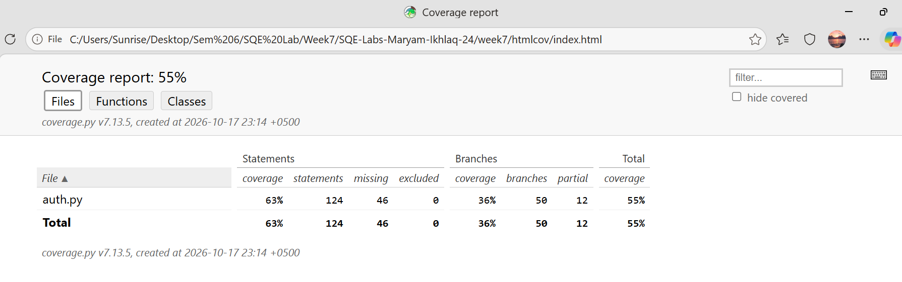
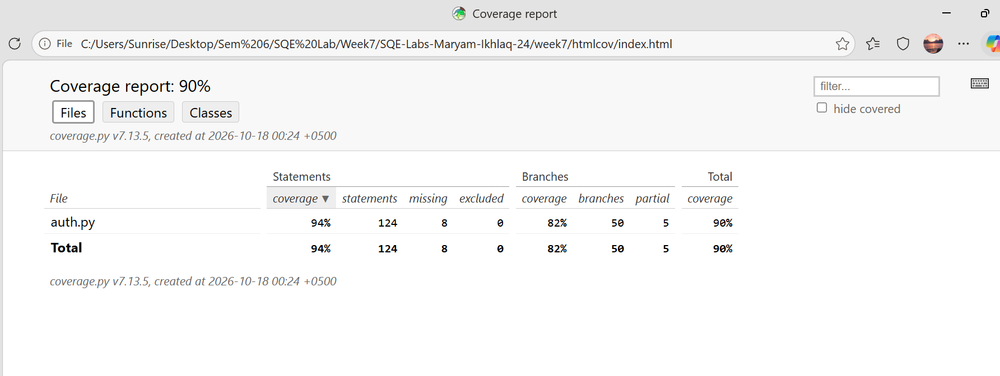
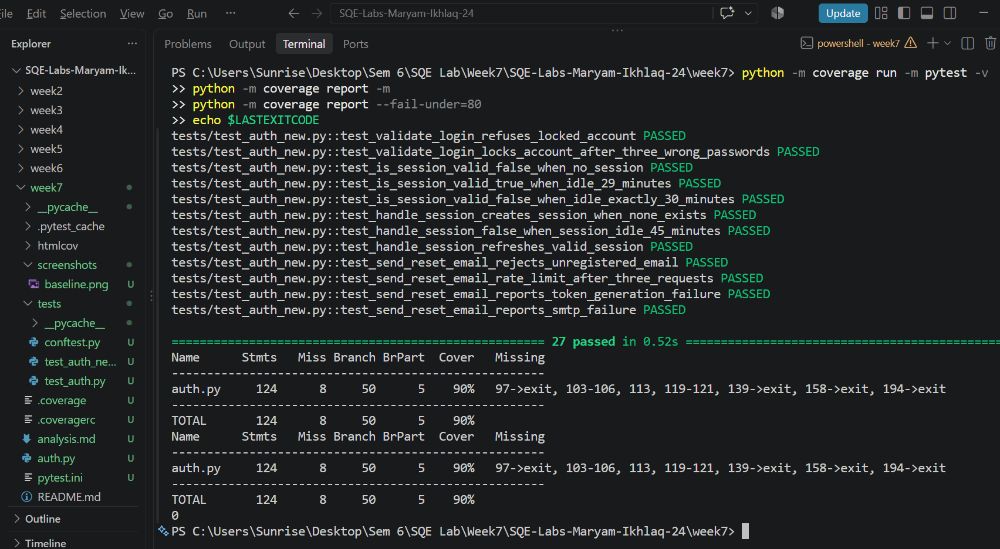

# SQE Lab 7 Analysis

Name: Maryam Ikhlaq    Roll Number: FA23-BSE-039

## 1. Baseline Evidence

Command: `python -m coverage run -m pytest tests/test_auth.py -v`, then `python -m coverage report -m`

Result: 7 passed.

| Name | Stmts | Miss | Branch | BrPart | Cover | Missing |
|---|---|---|---|---|---|---|
| auth.py | 124 | 46 | 50 | 12 | 55% | 60, 64, 70, 86, 88->90, 91, 96-98, 103-106, 113, 119-121, 139->exit, 147, 152, 157-159, 167-173, 193-195, 200-208, 219, 223, 227-228, 234-235 |
| TOTAL | 124 | 46 | 50 | 12 | 55% | |

## 2. Per-Function Baseline

Values from the HTML Functions tab. The lab's expected values are shown for comparison. My file's TOTAL matches the lab exactly (55%, 124 statements). The per-function differences are recorded as they appeared in my report.

| Function | Lab expected | My baseline | Note |
|---|---|---|---|
| validate_login | 79% | 81% | Close |
| check_lockout | 64% | 75% | Higher |
| is_session_valid | 67% | 75% | Higher |
| handle_session | 0% | 0% | Match |
| verify_reset_token | 0% | 0% | Match |
| send_reset_email | 58% | 60% | Close |

## 3. Gap Analysis

Priority rule (from the lab): High when the line enforces lockout, session timeout or token rules, or when the whole function is red. Medium otherwise.

The helper lines 96-98, 103-106, 113 and 119-121 belong to `lock_account`, `unlock_account`, `is_locked` and `reset_attempt_count`. They are left out of this table, as the lab instructs. Experiment D shows which of them the tests reach.

| Function | Missing lines | Condition not yet tested | Test idea (input and expected result) | Priority |
|---|---|---|---|---|
| validate_login | 60 | Email is not registered | `validate_login("ghost@uni.edu", "ValidPass1")` expect success False, user_id None, error "Invalid credentials" | Medium |
| validate_login | 64 | Account is locked | Lock student@uni.edu, then `validate_login("student@uni.edu", "ValidPass1")` expect error "Account is locked" | High |
| validate_login | 70 | Third wrong password locks the account | Call with "WrongPass9" three times, expect `is_locked` True | High |
| check_lockout | 86 | Account is already locked when called | Lock student@uni.edu, call `check_lockout(..., attempt_count=0)`, expect False | High |
| check_lockout | 88->90 | Unknown account at 3 attempts (condition `user is not None` never False) | `check_lockout("nobody@uni.edu", attempt_count=3)` expect False, no error | Medium |
| check_lockout | 91 | Attempt count below 3 is allowed | `check_lockout("student@uni.edu", attempt_count=2)` expect True, and `is_locked` False | High |
| destroy_session | 139->exit | Destroying a session that does not exist | `destroy_session("NOBODY")` expect no error, and session count unchanged | Medium |
| is_session_valid | 147 | No session exists | `is_session_valid("STU001")` with no session created, expect False | High |
| is_session_valid | 152 | Active session (idle 29 minutes) | `create_session("STU001", idle_minutes=29)`, expect True | High |
| update_session_activity | 157-159 | Refreshing an existing session | Create session idle 25 min, call `update_session_activity`, expect `last_activity` later than before | High |
| handle_session | 167-173 | New, expired and valid session paths | No session: True and session now valid. Idle 45 min: False. Idle 25 min: True and refreshed | High |
| mark_token_used | 193-195 | Token marked as used | Generate token, call `mark_token_used(token)`, expect `verify_reset_token(token)` False | High |
| verify_reset_token | 200-208 | Valid, unknown, expired and used tokens | Valid token True. Unknown token False. Token with `hours_ago=2` False. Used token False | High |
| send_reset_email | 219 | Email not registered | `send_reset_email("ghost@uni.edu")` expect sent False, error "Email address not found" | Medium |
| send_reset_email | 223 | Rate limit reached | Call `send_reset_email("student@uni.edu")` 3 times (all True), 4th expect sent False, error "Rate limit exceeded" | Medium |
| send_reset_email | 227-228 | Token generation fails | Patch `auth.generate_reset_token` with `side_effect=RuntimeError("boom")`, expect error "Token generation failed: boom" | Medium |
| send_reset_email | 234-235 | SMTP delivery fails | Patch `auth._deliver_email` with `side_effect=ConnectionError("server down")`, expect error "SMTP error: server down" | Medium |

## 4. Final Coverage

Final run: `python -m coverage run -m pytest -v`, then `python -m coverage report --fail-under=80`.

Result: 27 passed. TOTAL 90%. Exit code 0 (`echo $LASTEXITCODE`). A check with `--fail-under=95` returned exit code 2, which shows the threshold works.

Before and after, for the six functions:

| Function | Baseline (my value) | After Experiment D |
|---|---|---|
| validate_login | 81% | 100% |
| check_lockout | 75% | 100% |
| is_session_valid | 75% | 100% |
| handle_session | 0% | 100% |
| verify_reset_token | 0% | 100% |
| send_reset_email | 60% | 100% |

Residual lines (8 missing statements and 5 partial branches left at 90%):

| Lines | Function | What the line does | Test that would cover it |
|---|---|---|---|
| 97->exit | lock_account | The "if user is not None" check is never False, so an unknown email is never passed in | Call `lock_account("nobody@uni.edu")` and check that nothing raises |
| 103-106 | unlock_account | Unlocks a locked account and resets its attempt count. No test unlocks an account | Lock student@uni.edu, call `unlock_account`, and check that `is_locked` returns False |
| 113 | is_locked | Returns False for an email that is not registered. No test checks an unknown account | Call `is_locked("nobody@uni.edu")` and check for False |
| 119-121 | reset_attempt_count | Clears the failed attempt count of an account. No test calls it | Set `attempt_count` to 2, call `reset_attempt_count`, and check that it is 0 |
| 139->exit | destroy_session | The "if user_id in sessions" check is never False, so destroying a missing session is never tested | Call `destroy_session("NOBODY")` and check that nothing raises |
| 158->exit | update_session_activity | The "if session is not None" check is never False, so updating a missing session is never tested | Call `update_session_activity("NOBODY")` and check that nothing raises |
| 194->exit | mark_token_used | The "if reset is not None" check is never False, so marking an unknown token is never tested | Call `mark_token_used("no-such-token")` and check that nothing raises |

These lines were not targeted by the scenario tables, which focus on the main behaviour. Each one is a helper or a "not found" path. Writing a test for each would raise the total toward 100%, but the lab only requires 80% or more.

## 5. Observation

Coverage records that lines ran, not that the results were correct. In Experiment D Step 3, a test that calls `unlock_account` without an assert raised the total from 90% to 93%, but checks nothing.